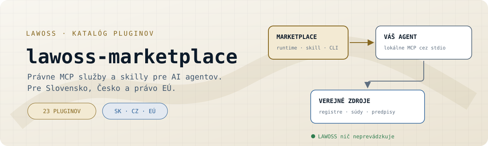
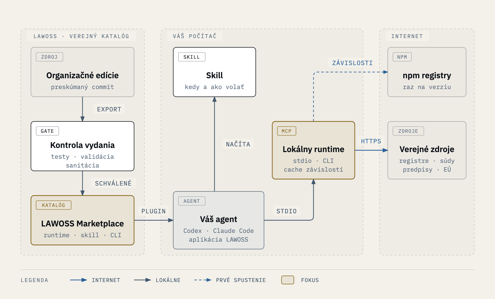
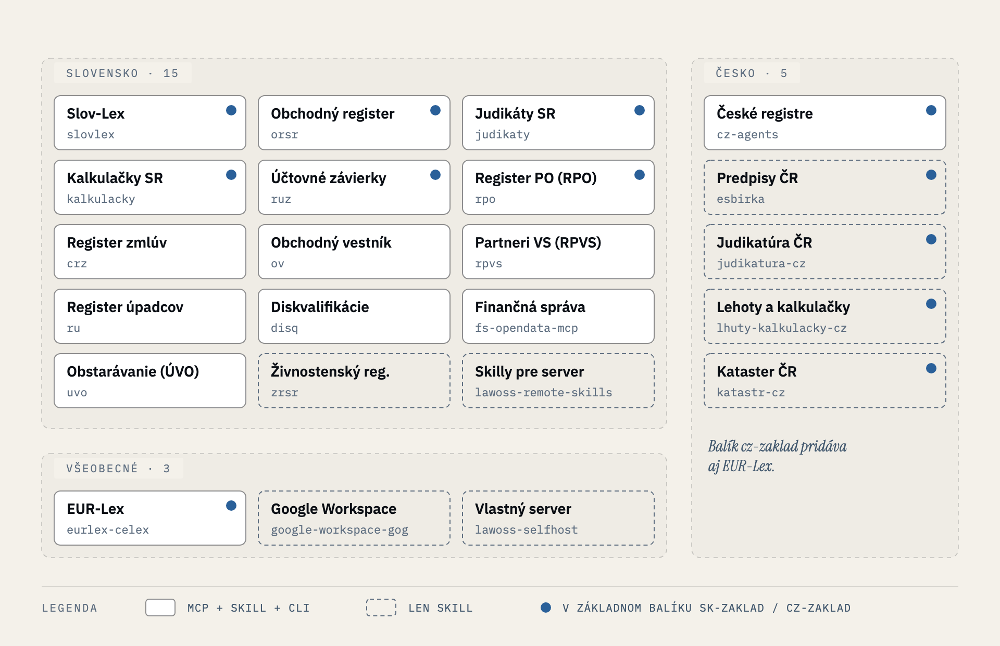
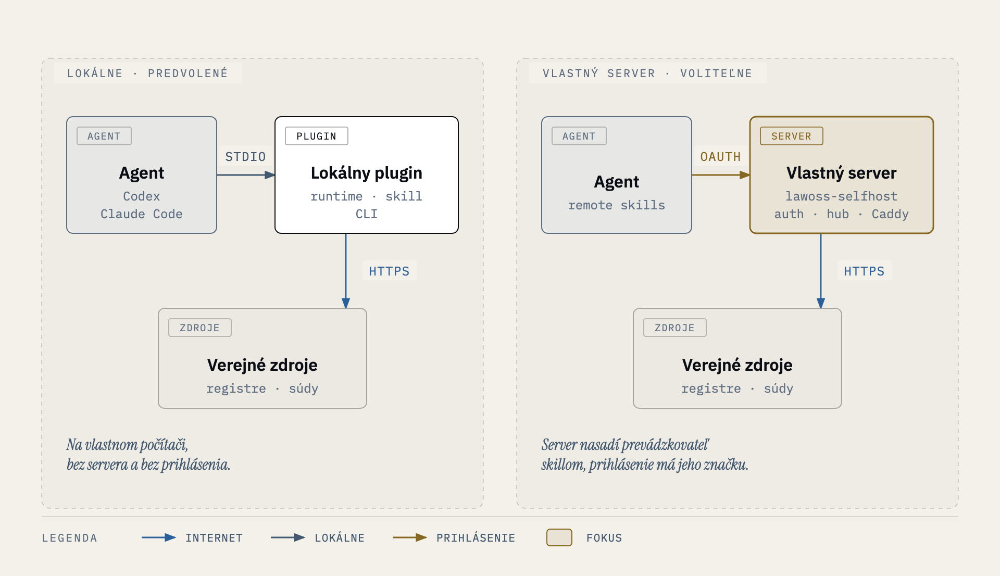

<picture>
  <source media="(prefers-color-scheme: dark)" srcset="docs/assets/lawoss-marketplace-hero-dark.svg">
  
</picture>

# LAWOSS Marketplace

<p><strong>Katalóg pluginov</strong> · Lokálne MCP služby · Skilly pre AI agentov</p>

[Katalóg](#katalóg) · [Inštalácia](#inštalácia) · [Aktualizácia](docs/updating.md) · [Vlastný server](#vlastný-server-lawoss-selfhost) · [Vydania pluginov](docs/RELEASES.md)

Toto je zdrojová distribúcia, nie prevádzkovaná služba. LAWOSS nič neprevádzkuje.

LAWOSS Marketplace je katalóg pluginov pre AI agentov (Codex, Claude Code a aplikáciu LAWOSS).
Pluginy sprístupňujú slovenské a české registre, súdne rozhodnutia, predpisy, právne kalkulačky
a právo EÚ. Väčšina pluginov obsahuje lokálny MCP server, skill, ktorý agentovi povie, kedy
a ako nástroje volať, a príkazový riadok. Všetko beží na počítači používateľa a číta verejné
zdroje priamo. Ak chce kancelária služby zdieľať, môže si ich nasadiť na vlastný server pomocou
skillu `lawoss-selfhost`.

**English summary.** A public catalog of LAWOSS plugins for AI agents: Slovak and Czech registers,
case law, legislation, legal calculators and EU law. Most plugins bundle a local stdio MCP runtime,
a usage skill and a CLI that run on the user's machine. LAWOSS does not host or operate any server
or endpoint, and no public hosting service is included. An operator may self-host the same reviewed
runtimes on infrastructure they control with `lawoss-selfhost`; the operator is then responsible for
that server, its users and respecting the terms of the public sources.

> [!IMPORTANT]
> Pluginy čítajú verejné zdroje, ale nie sú právnym poradenstvom ani autoritatívnou databázou.
> Inštalácia nedoplní chýbajúce dáta zdroja. Pokrytie a predpoklady (napríklad kľúče
> poskytovateľov) sú opísané pri každom plugine. Výsledky overujte v oficiálnych zdrojoch.

## Ako to funguje

<picture>
  <source media="(prefers-color-scheme: dark)" srcset="docs/assets/lawoss-marketplace-distribution-dark.png">
  
</picture>

- Do katalógu sa dostane iba edícia, ktorá prešla kontrolou vydania: testy zdroja, validácia
  katalógu a kontrola, že balík neobsahuje tajomstvá ani súkromnú infraštruktúru. Každý plugin
  zaznamenáva presný commit svojho zdroja v `releases.json`.
- Plugin s lokálnym MCP spúšťa runtime cez stdio a neotvára žiadny HTTP port. Pri prvom spustení
  si stiahne závislosti so zamknutými odtlačkami do cache používateľa. Ďalšie spustenia cache
  znova použijú.
- Skill-only pluginy server nemajú. Skill opisuje postup alebo verejné API, ktoré agent použije sám.

Podrobnosti: [prvé lokálne nasadenie](docs/local-runtime.md) ·
[pokrytie a cena kontextu](docs/full-rollout.md) · [model distribúcie](docs/distribution-model.html)

## Katalóg

23 pluginov v troch kategóriách. 15 z nich obsahuje lokálny MCP server, skill a CLI, ostatné sú
len skilly.

<picture>
  <source media="(prefers-color-scheme: dark)" srcset="docs/assets/lawoss-marketplace-catalog-dark.png">
  
</picture>

### Slovensko

| Plugin | Typ | Čo robí |
|---|---|---|
| [`slovlex`](plugins/slovlex/README.md) | MCP + skill + CLI | slovenské právne predpisy zo Slov-Lexu, znenie k dátumu, dôvodové správy |
| [`orsr`](plugins/orsr/README.md) | MCP + skill + CLI | verejné údaje Obchodného registra SR |
| [`judikaty`](plugins/judikaty/README.md) | MCP + skill + CLI | rozhodnutia slovenských súdov, NS SR a ÚS SR |
| [`kalkulacky`](plugins/kalkulacky/README.md) | MCP + skill + CLI | súdne poplatky, trovy konania, úroky z omeškania, lehoty |
| [`ruz`](plugins/ruz/README.md) | MCP + skill + CLI | účtovné závierky slovenských firiem |
| [`rpo`](plugins/rpo/README.md) | MCP + skill + CLI | identifikačné údaje právnických osôb |
| [`crz`](plugins/crz/README.md) | MCP + skill + CLI | zmluvy verejného sektora z Centrálneho registra zmlúv |
| [`ov`](plugins/ov/README.md) | MCP + skill + CLI | oznámenia v Obchodnom vestníku |
| [`rpvs`](plugins/rpvs/README.md) | MCP + skill + CLI | partneri verejného sektora a ich koneční užívatelia výhod |
| [`ru`](plugins/ru/README.md) | MCP + skill + CLI | konkurzy, reštrukturalizácie a oddlženia |
| [`disq`](plugins/disq/README.md) | MCP + skill + CLI | register diskvalifikácií |
| [`fs-opendata-mcp`](plugins/fs-opendata-mcp/README.md) | MCP + skill + CLI | otvorené dáta Finančnej správy SR; potrebuje vlastný `FS_API_KEY` |
| [`uvo`](plugins/uvo/README.md) | MCP + skill + CLI | vestník a zákazky Úradu pre verejné obstarávanie |
| [`zrsr`](plugins/zrsr/README.md) | skill | Živnostenský register SR cez samostatne pripojený MCP server; server nie je súčasťou balíka |
| [`lawoss-remote-skills`](plugins/lawoss-remote-skills/README.md) | skill | vzdialené verzie skillov 14 služieb pre používateľov vlastného servera LAWOSS |

### Česko

| Plugin | Typ | Čo robí |
|---|---|---|
| [`cz-agents`](plugins/cz-agents/README.md) | MCP + skill + CLI | ARES, ČNB, insolvenčný register a ďalšie české zdroje; osem samostatne voliteľných služieb |
| [`esbirka`](plugins/esbirka/README.md) | skill | znenie českých predpisov k dátumu z verejnej e-Sbírky, bez kľúčov |
| [`judikatura-cz`](plugins/judikatura-cz/README.md) | skill | judikatúra všeobecných súdov, NS, NSS a ÚS ČR z bezplatných verejných zdrojov |
| [`lhuty-kalkulacky-cz`](plugins/lhuty-kalkulacky-cz/README.md) | skill | lehoty, súdne poplatky, advokátska tarifa a úrok z omeškania podľa českého práva |
| [`katastr-cz`](plugins/katastr-cz/README.md) | skill | bezplatné REST API ČÚZK; vyžaduje vlastný bezplatný kľúč používateľa |

### Všeobecné

| Plugin | Typ | Čo robí |
|---|---|---|
| [`eurlex-celex`](plugins/eurlex-celex/README.md) | MCP + skill + CLI | právo EÚ podľa CELEX a ELI |
| [`google-workspace-gog`](plugins/google-workspace-gog/README.md) | skill | Gmail, Kalendár, Disk a Dokumenty cez lokálny nástroj gog; predvolene len čítanie |
| [`lawoss-selfhost`](plugins/lawoss-selfhost/README.md) | skill | nasadenie vlastného servera LAWOSS agentom, s potvrdeniami človeka |

### Odporúčané balíky

| Balík | Pluginy |
|---|---|
| **SK základ** (`sk-zaklad`) | `slovlex`, `orsr`, `judikaty`, `kalkulacky`, `ruz`, `rpo` |
| **CZ základ** (`cz-zaklad`, predbežný) | `esbirka`, `judikatura-cz`, `lhuty-kalkulacky-cz`, `katastr-cz`, `cz-agents`, `eurlex-celex` |

Verzie pluginov a commity ich zdrojov sú v `releases.json`. Poznámky k jednotlivým vydaniam sú
v priečinku [docs](docs/RELEASES.md).

## Inštalácia

**Predpoklady pre pluginy s MCP:** Node.js 22.14 alebo novší s npm a pri prvom spustení každej
verzie runtime prístup k registru npm. Prístup k súkromným zdrojovým repozitárom netreba;
preskúmaný runtime je súčasťou pluginu.

V Codexe:

```bash
codex plugin marketplace add https://github.com/Omni-Legal-Products/lawoss-marketplace.git --ref main
codex plugin add slovlex@lawoss
codex plugin list
```

Celý balík SK základ naraz:

```bash
for p in slovlex orsr judikaty kalkulacky ruz rpo; do codex plugin add "$p@lawoss"; done
```

V Claude Code:

```text
/plugin marketplace add Omni-Legal-Products/lawoss-marketplace
/plugin install slovlex@lawoss
```

V Claude Code 2.1.275 a novšom stačí jeden príkaz:
`/plugin install slovlex --marketplace Omni-Legal-Products/lawoss-marketplace`.

Po inštalácii začnite novú reláciu, aby agent načítal skill a nástroje. Každý plugin s MCP má aj
príkazový riadok, napríklad z priečinka nainštalovaného pluginu:

```bash
node scripts/run.mjs doctor
node scripts/run.mjs tools
```

> [!NOTE]
> Lokálne runtimy sú overené v Codexe na macOS. Katalóg pre Claude prechádza validáciou, ale
> beh runtimov v Claude a na Windows a Linuxe zatiaľ overený nie je.

Každý načítaný MCP pridáva do kontextu popisy svojich nástrojov. Všetkých 15 runtimov spolu má
143 nástrojov, čo zodpovedá približne 35 500 tokenom schém. Zapínajte preto len služby, ktoré
potrebujete ([odhad po službách](docs/full-rollout.md#context-cost)).

## Aktualizácia

```bash
python3 scripts/update_plugins.py --marketplace lawoss
python3 scripts/update_plugins.py --marketplace lawoss --apply
```

Prvý príkaz iba ukáže, ktoré nainštalované pluginy LAWOSS by aktualizoval. Druhý obnoví katalóg
a preinštaluje len tie pluginy, ktoré už máte; vypnuté pluginy ostanú vypnuté. Potom začnite
novú reláciu. Postup a obmedzenia sú v [návode na aktualizáciu](docs/updating.md).

## Vlastný server (lawoss-selfhost)

<picture>
  <source media="(prefers-color-scheme: dark)" srcset="docs/assets/lawoss-marketplace-modes-dark.png">
  
</picture>

Lokálne pluginy sú predvolené a nemenia sa. Kancelária, ktorá chce služby zdieľať medzi viacerými
ľuďmi a aplikáciami, si môže tie isté preskúmané runtimy nasadiť na vlastný server
s prihlásením so svojou značkou:

- Plugin [`lawoss-selfhost`](plugins/lawoss-selfhost/README.md) je skill, ktorý AI agenta
  prevedie nasadením v 15 krokoch. Pri každom kroku povie, čo urobí sám a čo potvrdí človek.
  Tajomstvá nevstupujú do konverzácie.
- Samotný server je verejný repozitár
  [lawoss-selfhost](https://github.com/Omni-Legal-Products/lawoss-selfhost/tree/9efec09a95c513ab88d9a1116bee96e1c6de40c1)
  (AGPL-3.0): proxy Caddy, prihlasovací server a hub so službami.
- Ľudia, ktorí sa na hotový server pripájajú, si nainštalujú
  [`lawoss-remote-skills`](plugins/lawoss-remote-skills/README.md), vzdialené verzie skillov
  bez lokálneho servera.

Za vlastný server, jeho používateľov a dodržiavanie podmienok verejných zdrojov zodpovedá ten,
kto ho prevádzkuje.

## Hranica distribúcie

- Pluginy neobsahujú prihlasovacie údaje, cesty konkrétnych používateľov, súkromnú
  infraštruktúru ani automatické pripojenie k osobnej MCP službe.
- Plugin sa stane dostupným až po tom, čo jeho organizačná edícia prejde celou kontrolou
  vydania. Rozpracované projekty nie sú inštalovateľné.
- Zdrojové repozitáre správcov sú súkromné; v katalógu sú preskúmané runtimy, ich licencie
  a odtlačky súborov.
- Prihlasovacie údaje, súhlasy OAuth ani dáta prevádzkovateľa nikdy neprichádzajú z katalógu.
  Aktualizácia katalógu nenasadí ani nezmení žiadny server.

## Pre správcov katalógu

- `.agents/plugins/marketplace.json` je kanonický katalóg pre Codex.
  `.claude-plugin/marketplace.json` je jeho významovo zladená projekcia pre Claude v inej
  schéme.
- `lawoss-catalog.json` nesie metadáta LAWOSS: kategórie podľa jurisdikcie (Slovensko, Česko),
  všeobecné pluginy, balíky a lokalizované názvy v slovenčine, češtine, angličtine a nemčine.
  `scripts/sync_claude.py` premieta kategóriu a jurisdikciu do `tags` katalógu Claude;
  validátor ich drží v súlade.
- Skill-only pluginy napísané priamo tu sú v `releases.json` pod `inRepoSkills`.
- Každý plugin je v `plugins/<názov>` a jeho cesta ostáva vnútri repozitára.
- Pred commitom: `python3 -m unittest discover -s tests -v`, `python3 scripts/validate.py`,
  `claude plugin validate --strict .` a `cmp AGENTS.md CLAUDE.md`. Pravidlá sú
  v [AGENTS.md](AGENTS.md).
- [Príprava vydania pluginu](docs/RELEASES.md) · [balenie runtime](docs/releasing.md)

Editovateľné zdroje diagramov: [distribúcia](docs/diagrams/lawoss-marketplace-distribution.html) ·
[mapa katalógu](docs/diagrams/lawoss-marketplace-catalog.html) ·
[lokálne alebo vlastný server](docs/diagrams/lawoss-marketplace-modes.html)

## Licencia

Pluginy postavené z organizačných edícií si nesú licenciu a atribúciu svojho zdroja (súbor
`LICENSE` v priečinku pluginu). Licencia ostatných pluginov je uvedená pri nich. Server
`lawoss-selfhost` je pod licenciou AGPL-3.0.
